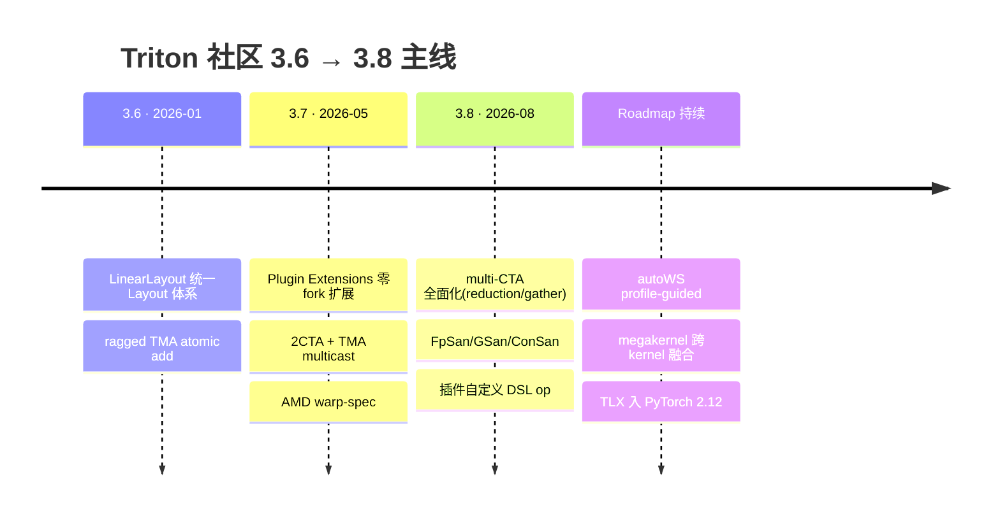
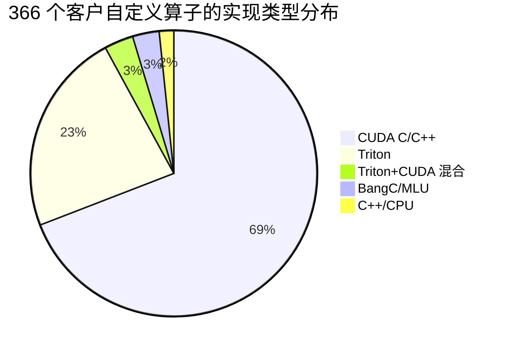

# Triton DSL 技术调研分析报告:社区演进 × 昇腾 TA 适配 Gap × 搜广推投入方向

> 生成时间:2026-10-21。
> 调研对象:上游 [triton-lang/triton](https://github.com/triton-lang/triton)(3.6 → 3.8)、本地 triton-ascend 仓库(基线 3.6.0,commit `5e55d2a23`)、Triton 社区 roadmap 博文与 PyTorch/Meta 搜广推 kernel 团队公开工作。
> 引用约定:正文以 `[S1]`–`[S12]` 标注网络来源、`[L1]`–`[L6]` 标注本地仓库证据,完整清单见文末"参考来源"。本报告为分析产物,如与官方文档冲突以官方为准。

---

## 0. 执行摘要

1. **社区主线已经明朗**:Triton 3.6(2026-01)→ 3.7(2026-05)→ 3.8(2026-08)的演进围绕六条线——①DSL 分层化(tl 之上的 Gluon 第一方低层语言 + TLX 第三方插件 + Helion 高层 DSL);②自动 Warp Specialization(autoWS)及其 profile-guided roadmap;③硬件原语标准化(TMA/multi-CTA/DSMEM/TMEM/CLC);④Layout 基础设施统一(LinearLayout);⑤**生态开放化(Plugin Extensions,零 fork 扩展编译管线,3.8 起支持自定义 DSL op,下一步是 out-of-tree 后端)**;⑥工程质量工具链(FpSan/GSan/ConSan sanitizer)[S1][S3][S4]。
2. **TA 最大结构性 Gap 不是"缺某个算子特性",而是"分发模式"**:社区已用 Plugin Extensions 解决了 fork 困境(fork 落后上游、merge 冲突、无法及时享受 bugfix/新硬件支持)[S4],而 triton-ascend 仍以 1192 行 patch 侵入上游 code_generator 的 fork 模式运行,基线停在 3.6.0,上游已到 3.8.0 [S1][L1][L2]。**PyTorch 2.12 起随 triton-ext 分发 TLX 后,生态若标准化到 plugin/triton-ext,不走 plugin 路线的后端将面临被排除在 Inductor 管线外的风险**[S4][S6]。
3. **能力性 Gap 集中在 GPU 硬件原语假设**:TMA(tensor descriptor 在 TA 恒降级为指针重写,[L3])、multi-CTA/DSMEM/cluster(社区归一化融合的核心机制)、mbarrier、CLC 在昇腾 A5 无硬件对应或需软件模拟[L1][L2];社区 pass(autoWS、memory planner、LinearLayout layout 体系)均以 GPU tensor core 为第一假设设计[S3][S1]。
4. **搜广推业务视角**:Meta 搜广推 kernel 团队近一年的三个标杆工作(fast_moe、Free Normalization、IKBO)证明**收益主要来自"kernel 结构 + 数学恒等式"层面的算法创新(warp specialization、多 CTA 协作归一化、kernel 内广播消除),而非单一指令替换**;其中 Lazy Pre-Norm 的数学恒等式 `(A·rstd)@B ≡ (A@B)·rstd`、IKBO 的"广播是布局问题非计算必需"洞察是硬件无关的,可优先在昇腾复现[S5][S6][S7]。昇腾还有增量筹码:cube/vector 物理双核天然构成 producer/consumer,`fixpipe` 的 pre-quant(F322BF16)/pre-relu 是 GPU 没有的"free"能力[L1]。
5. **优先级建议**:P0 做 plugin 化改造与 3.7/3.8 跟进(可持续性前提);P1 做搜广推算子专项(norm 融合、IKBO 广播消除、MoE、target-attention),用社区开源母本移植;P2 建设编译器自动化(自动 multibuffer/双核调度,对齐 autoWS 思路)与 profile 工具;P3 落地 tlx-ascend 翻译层承接 GPU 语料(已有立项分析)[L1]。

---

## 1. Triton 社区 3.6 版本至今的规划与演进趋势

### 1.1 版本时间线与主线特性

社区没有单独的 "4.0 大版本计划" 文档,roadmap 通过 **releases 说明、PyTorch 官方 roadmap 博文、triton-ext/plugin 文档**三个载体表达[S1][S2][S3][S4]。

| 版本 | 时间(发布 commit) | 主线特性 | 来源 |
|---|---|---|---|
| 3.4.0 | 2025-07-30 | Gluon 大幅扩展(static_assert、TensorDescriptor 实参、async TMA、tensor memory、barriers);NVIDIA 自动 warp specialization(autoWS)落地;MMAv5 pipelining;PDL;AMD GFX950 支持 | [S1] |
| 3.5.0 | 2025-10-21 | ragged TMA;warp-spec 加固(≥4 warps);ping-pong 变换;Gluon WGMMA;Blackwell TMEM 修复;GFX950(MI350)完整支持 | [S1] |
| 3.5.1 | 2025-11-12 | 修复 sm103(GB300)支持 | [S1] |
| **3.6.0** | 2026-01-21(`7c56a5e`) | `tl.trans/tl.dot` 多维 batch;ragged TMA atomic add;**CTALayout 改为 LinearLayout**;BF16x3;通用 `tcgen05.cp` lowering;AMD GFX1250(RDNA4)骨架 | [S1] |
| **3.7.0** | 2026-05-07(`5f3f125`) | **Plugin hooks(out-of-tree TTIR/TTGIR pass + Triton Dialect Plugins)**;端到端 2CTA mode;TMA multicast(`tcgen05.mma` multicast);warp-spec 支持嵌套 loop;AMD warp specialization + Tensor Data Movement(TDM)+ warp-pipeline | [S1] |
| 3.7.1 | 2026-06-18 | 回归修复(共享内存 store 与 async copy 之间缺失 FenceAsync 导致错误结果) | [S1] |
| **3.8.0** | 2026-08-28(`c01b677`) | `tl.aggregate/@gluon.aggregate` 转公开 API;**通用 multi-CTA 扩展到 layout conversion/reductions/gather-scatter/TMA multicast**;**sanitizer 三件套 FpSan/GSan/ConSan**;**插件可定义自定义 Python DSL op、扩展 AxisInfo 分析**;NVIDIA Rubin(SM107)初支持;AMD CDNA5(gfx1250)大版本(TDM 软件流水、descriptor gather/scatter、分区共享内存 layout、FP32 WMMA) | [S1] |

> 说明:triton-ascend 的基线正是 3.6.0(本地 `python/triton/__init__.py` `__version__ = '3.6.0'`)[L2],即社区在 3.6 之后又前进了两个 minor 版本。

### 1.2 社区重点规划的六大领域

#### ① DSL 分层化:一个编译器栈,三层语言
- **tl(高层,自动)**:面向 Inductor/Helion 生成与手写主力;3.7/3.8 持续增强(`tl.squeeze/unsqueeze`、scaled batched matmul、`tl.topk descending`、`tl.aggregate`)[S1]。
- **Gluon(第一方低层)**:同编译栈上对 layout/warp/调度完全控制的低层语言,是官方"降到硬件"的承接层;3.4–3.8 持续扩展(aggregate、Rubin 专属 Gluon 模块、AMD `warp_pipeline_stage`)[S1]。
- **TLX(第三方低层扩展,Meta)**:显式 smem/TMEM 管理、mbarrier、async_tasks 手动 warp specialization、TMA、CLC;经 **Plugin Extensions 零 fork 接入上游**(PyPI `triton-utlx`),并进入 **PyTorch 2.12 主线分发**(issue pytorch#178917,已关闭)[S4][S6][L1]。
- **Helion(PyTorch 高层 DSL)**:自动 tuning 驱动、强调可移植性与开发效率,Free Normalization 博客用它做非常规 tiling 的探索[S5]。
- 官方 roadmap 博文明确三层定位互补:tl 专注算法、Gluon/TLX 承担"手写/调试/极限优化"层(计划把编译器生成的 TTGIR 反向打印成可读 TLX 供人工 hand-tuning)[S3][L1]。

#### ② 自动 Warp Specialization(autoWS)
- 现状:`warp_specialize=True` 一个开关即可用(手写/Inductor/Helion kernel 均可),覆盖 Hopper+Blackwell;FA forward 在 B200 达到 Gluon/cuDNN 水平、stock Triton 的 1.5–2×(cuDNN 仍领先 10–20%)[S3]。
- 内部由 6 个 pass 组成:data partitioning → Loop Scheduler(SWP)→ Partition Scheduler → Buffer Creation(SMEM/TMEM channel)→ Memory Planner → Code Partitioner[第三,S3]。
- **短期 roadmap(<1 年)**:profile-guided partition 调度、profile-guided SWP(modulo scheduling + schedule autotuning)、Memory Planner 改进(DSL 级用户注解引导)、ping-pong 调度 pass、region 级显式 subtiling 语法糖、可调试性(TTGIR→TLX 反打印、分区/依赖图可视化)、泛化到 FA backward/flex attention/jagged attention、SOTA 硬件特性(Cluster Launch Control、DSMEM、multi-CTA、on-device TMA descriptor、AMD wave specialization)[S3]。
- **未来方向**:基于 cost model 的全局联合优化(分区/同步/内存/layout 联合搜索,Triton-MPP 采数);**IR 级 kernel 融合与 megakernel(重点:打通"用户手写 kernel × Inductor 自动生成 kernel"的 tile 级融合)**;数值确定性;计算/数据分离的语言抽象(引 Cypress PLDI'25、Halide)[S3]。

#### ③ 硬件原语标准化与多 CTA 协作
- TMA:3.5 ragged TMA、3.6 ragged TMA atomic add、3.7 multicast、3.8 TMA gather/scatter 与 on-device descriptor pipeline[S1][S3]。
- multi-CTA/cluster:3.7 端到端 2CTA mode;3.8 把通用 multi-CTA 支持扩展到 layout conversion、reductions、local gather/scatter、multicast——这是"跨 CTA 协作归一化"(见 §3.2)能在 DSL 层表达的基础设施[S1]。
- 内存层级:TMEM(Blackwell tensor memory)作为 channel 载体进入 buffer creation/memory planner 流程[S3]。

#### ④ Layout 基础设施统一
- CTALayout 全面 LinearLayout 化(3.6)、LinearSharedEncoding、通用 convert_layout swizzling、warp-local layout conversion(3.5)、layout/dropdown 体系修复贯穿 3.7/3.8[S1]。LinearLayout 已成为社区 layout 推导/优化的统一数学表示。

#### ⑤ 生态开放化:Plugin Extensions(对本调研最重要的主线)
- PyTorch-Triton 3.7 引入:`TRITON_PLUGIN_PATHS` 运行时加载 `.so`,**不 fork、不重编译**;可插/禁/替换任意 stage 的 pass,直至覆盖整个 pipeline;支持自定义方言+方言转换 pass+**顶层 Python DSL op**;per-kernel 开关;插件自管 cache hash[S4]。
- 官方明示 fork 的代价:"forks quickly fall behind upstream…fork becomes a bottleneck rather than an accelerator"[S4]。
- TLX 是第一个消费者,identical codegen 已验证(H100 PTX、MI350 AMDGCN 与 fork 完全一致)[S4]。
- **What's Next 官方清单**:动态加载的 out-of-tree **custom backends(Intel、CPU 等)**、triton-distributed、Proton/ConSan 插件化、target-specific warp specialization、2:4 稀疏等专用 op[S4]。→ 这意味着"昇腾以 out-of-tree 形态进入上游生态"在社区路线图上是**被官方预留的方向**。
- 佐证:`triton.knobs.runtime.add_stages_inspection_hook` 已写入上游 README 作为 out-of-tree pass 的官方入口[S2];推理框架侧 SGLang 亦在按 out-of-tree platform 模式接入昇腾 NPU[S12]。

#### ⑥ 工程质量与工具链
- 3.8 发布 FpSan(符号化浮点检查)、GSan(data-race)、ConSan(并发检查,扩展到 multi-CTA/TMA/multicast/CLC)[S1];
- Proton intra-kernel tracer 已是社区调试标配(IKBO 博客用它验证四重重叠)[S6];
- autoWS roadmap 中 debuggability 单列一节(TTGIR→TLX、分区可视化、交互式决策)[S3]。

### 1.3 演进趋势判断

1. **"编译器自动化"与"低层逃生舱"双轨并行**:autoWS 把复杂调度收归编译器(profile-guided、cost model 是下一步),同时 Gluon/TLX 给专家留手动控制层,且两者互转(TTGIR→TLX)——社区赌的是"自动为主、手动兜底"。
2. **多 CTA 协作是当前最重要的新编程模型**:从硬件特性(TMA multicast/cluster/DSMEM)到 DSL 语义(multi-CTA norm、megakernel)正在打通,直接催生 §3.2 的搜广推算法创新[S1][S3][S5]。
3. **生态权力下放**:plugin 化让"fork 后端"模式被官方判定为反模式,后端/扩展的竞争转向"谁的插件先适配新上游、谁先进入 PyTorch 发行链"[S4][S6]。
4. **硬件覆盖从"NVIDIA 优先"走向 NVIDIA/AMD 双主力 + 插件化长尾**:每个 minor 版本 AMD 特性比重显著上升(SO gfx1250/CDNA5 大版本),Rubin 首发[S1];而 NPU 类架构目前没有任何第一方代表——这是昇腾的机会窗口。

---

## 2. TA(triton-ascend)适配现状与社区支持特性的 Gap

### 2.1 TA 现状速览

- **基线**:上游 3.6.0;主包 `python/triton/` 与上游逐字节一致(原生 API 零增删)[L2]。
- **扩展 API**:三层——`al`(`triton.language.extra.cann.extension`,63 项导出:cube/vector scope、sync_block 事件、fixpipe、custom op 等)、`bl`(`triton.extension.buffer.language`,UB/L1/L0A/L0B/L0C 地址空间 memref)、`cann.libdevice`(177 个数学函数);另有 `libentry/libtuner`(FlagGems 风格)、`ubtuner`(UB 溢出自动调优)、`do_bench_npu`(mspti/profiler)[L2][L4][L5]。
- **前端注入**:构建期 patch(`third_party/ascend/patch/triton-ascend-3.6.0.patch`,1192 行改 16 文件)侵入上游 code_generator(重写 `visit_With`、注入 builder)+ ~50 个 C++ 方法 setattr 到 `ir.builder`[L1][L2]。
- **编译管线**:TTIR → ttadapter → mlirbc → bcmlir(bishengir-opt)→ npubin;仓库内 `ascend` 方言 + 外部 BiShengIR 的 `hivm.hir.*`[L1][L6]。
- **A5 硬件模型**:cube/vector 物理双核(scope + sync_block event + sub_vec_id)、MTE 多级 pipe、L0C 累加器 + fixpipe(pre-quant/pre-relu)、UB 256KB(950 前 192KB)、SIMT 模式(实验性)、无 TMA/mbarrier/CLC 硬件[L1][L2]。

### 2.2 与社区特性的逐项 Gap 对照

| # | 社区特性(版本) | 社区状态 | TA 状态 | Gap 定级 | 依据 |
|---|---|---|---|---|---|
| 1 | **Plugin Extensions / out-of-tree 扩展**(3.7/3.8) | `TRITON_PLUGIN_PATHS` 动态加载,自定义方言/op/pass,TLX 零 fork;3.8 支持自定义 DSL op 与 AxisInfo 扩展;官方下一步 = out-of-tree backend | 构建期 1192 行 patch 侵入 code_generator;整仓 fork 分发(`install_requires triton==3.6.0`) | **结构性,P0** | [S4][L1][L2] |
| 2 | **上游版本跟随** | 已到 3.8.0(2026-08-28) | 停在 3.6.0(2026-01-21),差 2 个 minor | **结构性,P0** | [S1][L2] |
| 3 | **autoWS 自动 warp specialization**(3.4+,持续 roadmap) | `warp_specialize=True` 开箱;Hopper/Blackwell;FA fwd 接近 cuDNN;roadmap 走 profile-guided | 无自动执行分区;手动对应物是 `al.scope(cube/vector)` 核级并行 + sync_block(粒度更粗但昇腾双核天然并行);SIMT 模式承接 warp 线程语义(实验性) | 能力性(自动部分缺失,手动部分有对等物) | [S3][L1] |
| 4 | **TMA / TensorDescriptor**(3.4→3.8 持续增强) | ragged/multicast/gather-scatter/on-device descriptor | `tensor_descriptor` 恒被 `add_rewrite_tensor_descriptor_to_pointer` 降级为指针([L3]);社区博客里 TMA 依赖的 kernel 结构(异步预取、descriptor 复用)不可表达 | **能力性,P1**(影响社区 kernel 移植保真度) | [S1][L3][L1] |
| 5 | **multi-CTA / cluster / DSMEM**(3.7/3.8) | 2CTA mode、通用 multi-CTA reduction/layout conversion、multicast | 无 CTA cluster 硬件;跨 program 协作只能走 GM/L2 + 同步;"Multi-CTA Norm"类算法无硬件直译 | **能力性,P1**(§3.2 算法受影响) | [S1][S5] |
| 6 | **mbarrier(phase/expect_bytes)** | tlx.mbarrier 族、autoWS channel 同步基础 | `sync_block_set/wait`(event 0–15 + pipe 属性),无 phase/byte-count 语义;`sync_block_lock` 自旋锁 | 能力性(可映射、需适配) | [S4][L1] |
| 7 | **Gluon(第一方低层语言)** | 上游主线,aggregate/每代硬件专属模块 | 无对应物;`al/bl` 是昇腾私有形态,Gluon 生态 kernel 无法运行 | **生态性,P2**(语料不可迁移) | [S1][L1] |
| 8 | **LinearLayout/CTALayout 统一 layout 体系**(3.5/3.6) | layout 推导的统一数学基础设施 | 自有 fractal zN layout(`al.dot format="fractal"`)与 `hivm.hir.convert_layout`;未跟进 LinearLayout 体系 | 能力性,长期维护成本项 | [S1][L1] |
| 9 | **Sanitizer/Proton 工具链**(3.8) | FpSan/GSan/ConSan;Proton intra-kernel tracer | `do_bench_npu`(mspti/torch_npu.profiler)只覆盖计时,无 kernel 内数值/竞态/并发检查等价物 | **工具链 Gap,P2**(难排查 kernel 数值/同步 bug) | [S1][S6][L5] |
| 10 | **Inductor/PyTorch 发行链**(PyTorch 2.12) | TLX 随 triton-ext 进入 PyTorch 主线;autoWS 明确面向 Inductor 生成 kernel;社区在打通用户 kernel × Inductor kernel 融合 | 用户必须切换到 triton-ascend fork 才能在 NPU 跑 Inductor Triton kernel | **生态性,P0**(脱钩风险) | [S3][S6][L1] |
| 11 | 原生 API 行为泛化 | `tl.range` 的 `num_stages/loop_unroll_factor/warp_specialize`、`eviction_policy`、`Config.num_stages/num_ctas/maxnreg` 等在 GPU 全量生效 | `eviction_policy` 无效;`num_stages/num_ctas/maxnreg` 不适用;`tl.range` 部分 flag 功能不完整;grid 首维(coreDim)≤65535;32B/512B 对齐约束 | **泛化差距**(同一段社区 kernel 代码在 TA 上行为/性能不同) | [L2] |
| 12 | CLC(Cluster Launch Control,动态 launch) | TLX/3.8 已用(B200 pipeline) | 无对应(grid 静态,auto-blockify 折叠) | 能力性,可裁剪 | [S4][L1] |

### 2.3 泛化支持差距的根因分析

**(a) 分发结构差距是"因",其余多为"果"。** 上游 3.7 起官方把"fork"定义为反模式并给出 plugin 解法[S4];TA 的 patch 模式导致每次跟进上游都要重做 1192 行 patch,跟进成本 O(版本),于是实际停留在 3.6.0——而 3.7/3.8 的 plugin、multi-CTA、sanitizer、aggregate 等特性反过来又被这个滞后挡在门外[L1][S1]。**一旦迁移到 plugin/triton-ext 模式,Gap #1/#2 解除,且"昇腾后端作为 out-of-tree 插件"正是官方 What's Next 点名的方向(custom backends: Intel、CPU…)**[S4]。

**(b) 硬件假设差距:社区特性的"第一假设"是 NVIDIA GPU。** TMA/cluster/DSMEM/TMEM/CLC/mbarrier 全部源自 NVIDIA 逐代硬件,AMD 是追赶的第二主力[S1];昇腾的 Cube/Vector 双核 + MTE + 分级片上存储(UB/L1/L0)模型与 GPU warp 模型在语义层不同构[L1][L2]。因此:
- 社区的**编译器自动化 pass**(autoWS 的 partition/memory planner、LinearLayout 体系)不能被 TA 直接复用,需要昇腾版"等价物"——好消息是部分等价物已存在(自动 multibuffer、`enable_hivm_auto_cv_balance` 双核负载均衡、ubtuner 自动调优)[L5],缺的是把它们统一成 autoWS 式的"声明一个开关,编译器全权负责"体验;
- 社区的**算法层创新**(数学恒等式、kernel 结构)与硬件无关,可以低成本移植(§3.2)——这正是搜广推业务收益最快的部分。

**(c) 行为泛化差距:同一份社区 kernel 代码在 TA 上的"静默降级"面较大。** `eviction_policy`/`num_stages`/`num_ctas`/`tl.range` flag 等社区 kernel 常用旋钮在 TA 上无效或不完整[L2],导致"能编译 ≠ 能得到社区同级性能",也使社区 autotune 空间(GPU 上的 tuning 维度)在 TA 上不可比。这属于**泛化支持差距中最影响用户心智的部分**:需要显式的兼容性声明与自动降级提示(TA 已有 `_ascend_constraints.py` 约束文档,但用户感知路径弱)[L2]。

**(d) TA 的非 Gap 项(对等甚至超出的能力)**,避免"只看差距"的误判:
| 能力 | TA 侧事实 | GPU 社区对应 |
|---|---|---|
| 双核生产者/消费者 | `scope(cube/vector)` + sync_block 事件是**物理双核**并行 | warp 分区(逻辑分区,硬件竞争) |
| 归一化/量化 free 化 | `fixpipe` 在 L0C→UB 搬出时顺带 pre-quant(F322BF16)/pre-relu | 需要显式 epilogue op |
| 零拷贝 gather | `index_select_simd`(GM→UB 零拷贝)、`bl.subview` 视图 | 需 TMA/共享内存中转 |
| UB 自动调优 | `@ubtuner` 贪心搜索 bisheng 编译选项组合 | Helion autotune(维度不同) |
| `max_autotune` 按 cube/mixcv/vector 三类算子展开调参 | [L5] | triton.Config 空间 |

---

## 3. 搜广推业务视角:follow 社区进展的优先级与重点投入

### 3.1 社区搜广推动向:三个标杆工作说明什么

| 工作 | 核心方法 | 收益(硬件) | 对搜广推业务的意义 | 来源 |
|---|---|---|---|---|
| **Free Normalization**(2026-07) | ① Lazy Pre-Norm:无 affine RMSNorm 用恒等式 `(A·rstd)@B ≡ (A@B)·rstd` 把 prologue 归一化延迟到 GEMM k-loop 之后;② Multi-CTA Norm:CTA cluster+DSMEM 把 post-norm 融合进 GEMM epilogue,backward 用"前后向融合到不同 Linear"重组;③ FlashNormAttention:GDPA attention 前后双 norm + 残差 megakernel | 隐藏最高 **90%** 归一化延迟;FlashNormAttention **+35%**(B200) | 归一化占 Meta 搜广推基座 Kunlun 训练延迟 ~20%(LLM ~10%),是搜广推最大单项 memory-bound 开销;Kunlun/GEM(生成式广告大模型)全链路都有 LN/RMSNorm | [S5] |
| **IKBO**(2026-05) | "广播是布局问题非计算必需":user 侧(RO)嵌入不复制,interaction kernel 接受 user/candidate 两种 batch 并 kernel 内广播;LCE 四阶段(分解→对齐 padding→epilogue 融合→warp-specialized 持久化多级融合) | LCE 累计 **~4×**(H100);IKBO FA 从 IO-bound 转 compute-bound(**621 BF16 TFLOPs**),2.4×/6.4× vs CuTeDSL FA4;计算密集 net 延迟最多降 **2/3** | 已部署 Meta 全推荐漏斗(GPU+MTIA),是 Adaptive Ranking Model 的扩展性基座;user 嵌入被广播 ~70× 的开销正是搜广推 ranking 模型的通病;target attention(候选×用户历史)占 1K 序列长度下 ~40% 推理延迟 | [S6] |
| **fast_moe**(meta-recsys,在维护) | MoE 层的 PyTorch/Triton/Triton-FP8 kernel:fused index_select+BMM、SiLU 融合、jagged tensor dispatch/combine、专家并行 | A100/H100,生产代码开源 | Meta 官方搜广推组织的 MoE 基建,生成式推荐(GEM/HSTU 类)的 MoE 结构可直接对标;指数级依赖 `fbgemm_gpu`/`mslk` | [S7] |

**共性结论**:三家收益都来自 **kernel 结构创新**(producer/consumer 重叠、多 CTA 协作、kernel 内广播、megakernel)+ **数学恒等式**(行缩放交换、零填充等价),工具载体是 **TLX/autoWS 级低层控制 + Helion 自动搜索**,而非等编译器自动进化[S5][S6][S7][S3]。这决定了昇腾 follow 的正确姿势:**算法层立即移植(硬件无关),结构层用昇腾原语重构(双核/fixpipe/subview),编译器层按 roadmap 分期补齐**。

### 3.2 参考工作 → 昇腾 A5 的映射(复用并更新本地立项分析[L1])

| 参考工作结构 | 昇腾映射 | 映射判定 |
|---|---|---|
| Lazy Pre-Norm 恒等式 | 纯数学,直接复用;square_sum 累加落在 vector 核,matmul 落在 cube 核,天然双核重叠 | ✅ 直接复用,昇腾契合度不低于 GPU |
| Multi-CTA Norm(cluster+DSMEM 跨 CTA 规约) | 无 cluster 硬件;替代路径:cube/vector 双核内 UB 乒乓 + sync_block;或同 coreDim 内多 program 经 GM 小张量(规约结果仅 1D,通信量小) | ⚠️ 需重构,规约量小可行性高 |
| FlashNormAttention(TMEM accumulate 放残差、register subtiling、WS 五分区) | L0C≈TMEM(残差可并入 cube 累加);`fixpipe` pre-quant/pre-relu 吃掉一部分 epilogue;WS 分区由 scope(cube/vector)+sub_vec_id 表达 | ⚠️ 结构可映射,子tiling 需手动 |
| IKBO LCE:分解/对齐 | PyTorch 层改动,硬件无关 | ✅ 直接复用 |
| IKBO LCE:epilogue 融合广播 | Triton epilogue 内 index 查表 + 寄存器加,TA 用 `bl.subview`/`index_select_simd` 零拷贝取 user 结果 | ✅ 且昇腾零拷贝原语更全 |
| IKBO LCE:warp-specialized 持久化多级融合(4 重重叠、mbarrier 复用、release-acquire) | MTE 多级 pipe + multibuffer 承载流水;sync_block 替代 mbarrier(无 phase,需适配);跨核用 sync_block event | ⚠️ 可映射,同步语义需改写 |
| fast_moe fused index_select+BMM、jagged dispatch | 昇腾 `index_select_simd` + `al.dot`;jagged 走 UB 内 `insert_slice/extract_slice` | ✅ 值得列为首批移植母本 |

**收益锚点(昇腾侧需自建 baseline)**:GPU 侧已证明的相对收益(norm 隐藏 90%、FNA +35%、LCE 4×、IKBO FA 2.4×/6.4×)[S5][S6];昇腾目标建议定义为"Inductor 原生两算子拼接 vs 融合 kernel"的同口径差值(与本地立项文档口径一致[L1])。

### 3.3 优先级建议

| 优先级 | 方向 | 具体动作 | 判定依据 |
|---|---|---|---|
| **P0(可持续性前提,先做)** | **plugin 化改造 + 上游跟随** | ① 评估把 triton-ascend 扩展从 1192 行 patch 迁移到 3.7+ Plugin Extensions(`TRITON_PLUGIN_PATHS`,自定义方言/op/pass hook);② 建立"基线 N-1 跟随"机制(当前 3.6→至少跟到 3.7/3.8);③ 跟踪 triton-ext/out-of-tree backend 演进,争取"昇腾后端插件"进入官方 What's Next 生态位 | fork 被官方定性为反模式[S4];PyTorch 2.12 起 TLX 进主线,生态标准化后不走 plugin 的后端有脱钩风险[S6][S4];plugin 模式同时解决 Gap #1/#2 |
| **P0(同步)** | **Inductor 通路保持** | 确保 Inductor 生成的 Triton kernel 在 NPU 上可用且随 PyTorch 主线演进;防止 torch 升级即断 | autoWS/社区融合明确以 Inductor kernel 为作用对象[S3];TA 现要求用户换 fork[L1] |
| **P1(业务收益主战场)** | **搜广推算子专项移植** | ① norm 融合(Lazy Pre-Norm 恒等式 + 双核重叠,目标 LN/RMSNorm+GEMM/attention 热点);② IKBO(LCE 四阶段 + target attention,user/candidate 双 batch kernel);③ MoE(fast_moe 母本:fused index_select+BMM/jagged);④ GDPA/target-attention 专项 | 三项社区工作直接对标搜广推最大开销项(norm ~20%、广播 70×、target attention ~40%)[S5][S6];母本全部开源可直接移植[S5][S6][S7] |
| **P2(泛化性能地基)** | **编译器自动化与工具链** | ① 把已有自动 multibuffer/`enable_hivm_auto_cv_balance`/ubtuner 统一成"autoWS 式"单开关体验(对齐社区 profile-guided 方向);② 基于 mspti 建 kernel 内 profile/cost model(对齐 Triton-MPP);③ 数值/竞态 sanitizer 与 kernel 内 tracer 等价物 | 社区 roadmap 把 profile-guided 与工具链列为主航道[S1][S3];TA 缺失导致复杂 kernel(debug 靠打印)[L1] |
| **P3(生态承接)** | **tlx-ascend 翻译层** | 按已完成立项分析执行:M1 tlx API 子集+映射层 → M2 样板算子(norm+GEMM、LCE)→ M3 NGO-agent 集成 → M4 随版发布 | GPU tlx 语料丰富、kernel 结构可迁移;al/bl 与 tlx 是出口/入口上下层关系[L1] |
| **贯穿约束** | **泛化行为声明** | 把 `_ascend_constraints.py` 的约束接入编译期 warning(社区旋钮被忽略时显式提示),并在文档给出"社区 kernel 移植检查单" | 静默降级是泛化差距最伤用户的部分[L2] |

### 3.4 投入逻辑总结

- **不要试图"全量对齐"社区 GPU 特性**:TMA/cluster/CLC 在昇腾无硬件对应,生硬模拟收益低、维护高;应按"算法可移植 → 结构重构 → 硬件裁剪"三层分流(本地立项分析已给出 API 级映射表[L1])。
- **业务收益最大的部分恰好硬件无关**:搜广推三大痛点(norm、广播、MoE/target-attention)的社区解法核心是数学恒等式 + kernel 结构,可以在现有 TA 原语(scope/sync_block/fixpipe/subview/index_select_simd)上立即落地,不必等 P0/P2 完成。
- **plugin 化是唯一能让所有后续投入复利的动作**:它同时降低跟进成本、接入 Inductor/PyTorch 发行链、并让 tlx-ascend 这类前端层无需 patch 即可挂载[S4]。

---

## 4. 结论

1. 社区 3.6→3.8 的演进主题 = **低层化(Gluon/TLX)+ 自动化(autoWS)+ 协作化(multi-CTA)+ 开放化(plugin)**,其中 plugin Extensions 是改变后端生存方式的分水岭[S1][S3][S4]。
2. TA 与社区的差距分三类:**结构性**(fork/patch、版本滞后,可由 plugin 化根治)、**能力性**(TMA/multi-CTA/mbarrier/CLC/Gluon/sanitizer,其中多数源自硬件模型差异,应有选择地裁剪或重构)、**泛化性**(社区 kernel 旋钮在 TA 上静默降级,需显式声明)[S4][S1][L1][L2][L3]。
3. 对搜广推业务,社区标杆已证明价值路径:**先用硬件无关的算法层创新(norm 恒等式、IKBO 分解、MoE 融合)在现有 TA 原语上拿收益**,同步推进 plugin 化与自动化建设,以 tlx-ascend 翻译层承接社区语料——三层并行、互不阻塞[S5][S6][S7][L1]。

---

## 5. 一页 PPT 内容布局方案:"Triton:社区规划 · 搜广推实践 · 客户现状 · 关键差距"

> 面向管理层/评审的一页 16:9 PPT。原则:四象限 + 底部行动条,每象限 ≤4 条要点 + 1 张图;以下 mermaid/表格均为可直接渲染或照排的图表示例。数据出处见 §5.6。

### 5.0 标题方案与版面总览

**推荐标题(结论式,呈现"特性变动 → 对昇腾影响 → 行动"完整逻辑链)**:

> # Triton 转向插件化开放生态、26% 客户算子已 Triton 化:昇腾 fork 跟随模式面临脱钩,宜尽早插件化

备选(按侧重):①*Triton 以插件化重构扩展生态、以 autoWS 收编性能优化,昇腾 fork 模式难以承接*(双特性并列:生态开放+编译器自动化);②*Triton 插件化令 fork 后端逐步出局,昇腾 3.6 基线与 1192 行 patch 难以持续跟进*(风险最尖锐,适合争取立项);③*搜广推算子加速 Triton 化(26%),社区插件化生态下昇腾需重构跟进路径*(客户趋势前置)。

```
┌────────────────────────────────────────────────────────────────────┐
│ 标题:Triton 转向插件化开放生态、26% 客户算子已 Triton 化:                    │
│       昇腾 fork 跟随模式面临脱钩,宜尽早插件化                               │
│ (无副标题;四个象限标题即"社区规划/搜广推实践/客户现状/关键差距")             │
├───────────────────────────────┬────────────────────────────────────┤
│ ① 社区规划(时间线图)            │ ② 搜广推怎么用(标杆+收益条形图)         │
├───────────────────────────────┼────────────────────────────────────┤
│ ③ 客户自定义算子现状(环形图+数字) │ ④ 关键差距(三色矩阵)                 │
├───────────────────────────────┴────────────────────────────────────┤
│ 行动条:P0 plugin化 → P1 norm/IKBO/MoE 移植 → P2 自动化 → P3 tlx-ascend │
└────────────────────────────────────────────────────────────────────┘
```

### 5.1 象限① 社区规划(左上)

关键结论(1–3 条):
1. **社区主航道 = 插件化开放生态**:3.7 起 Plugin Extensions 零 fork 扩展编译管线,官方明示 fork 是反模式 → **直接决定昇腾的跟进方式,不迁移就跟不上版本**
2. **autoWS + multi-CTA 是性能演进主线**:自动流水一个开关接近 cuDNN(1.5–2× stock);跨 CTA 协作成为归一化融合等新算法的基座 → **推荐场景热点 kernel(norm/attention 融合)的性能来源**
3. **TLX 低层语料进入 PyTorch 2.12 主线** → Meta 搜广推 kernel 资产(GPU)理论上可向昇腾迁移,前提是有承接层

图示例(mermaid timeline,渲染后贴入):



### 5.2 象限② 搜广推怎么用(右上)

关键结论(1–3 条):
1. **推荐三大性能痛点已被社区开源 Triton kernel 全部命中**:归一化 ~20% 训练延迟(隐藏 90%)、user 嵌入广播 ~70×(LCE 4×)、target attention ~40% 推理延迟(2.4×/6.4×)——**这些痛点同样存在于国内推荐模型**
2. **收益来自 kernel 结构 + 数学恒等式,硬件无关** → 昇腾可低成本移植,不必等编译器能力补齐
3. **Meta 已在全部推荐漏斗部署(GPU+MTIA),Triton 是搜广推 kernel 的事实载体** → 不跟进 = 与头部搜广推工程实践脱钩

图示例(收益条形,照排或用 PPT 原生条形图):

| Meta 标杆(全部开源) | 核心手段 | 收益(已发表) | 条形示意 |
|---|---|---|---|
| Free Normalization | Lazy Pre-Norm 恒等式 + multi-CTA epilogue | 隐藏 90% norm 延迟 / FNA +35% | ██████████ |
| IKBO(LCE/FA) | kernel 内广播消除 + WS 持久化融合 | LCE ~4× / FA 621 TFLOPs | ████████ |
| fast_moe | fused index_select+BMM / jagged | 生产代码开源 | ███ |

### 5.3 象限③ 客户自定义算子现状(左下)

关键结论(1–3 条):
1. **客户已规模化用 Triton,不是趋势是现状**:366 个自定义算子中 26% Triton 化,功能 top 与推荐模型结构一一对应(attention 55 / MoE 45 / norm 44 / embedding 26);字节、Shopee、腾讯 WXG 等 5 家头部客户均在用
2. **A5 实测收益确定**:Inductor+Triton 算子数 -35~47%、device 时间 -20~37%(字节 19 模型 + qianchuanv3)
3. **现存卡点正是昇腾后端的投入方向**:大 bs 下 Triton tiling 输 CANN(BMM +25%)、2 个模型编译失败、融合后 embedding 查表瓶颈(Slice 占 26~40%)——**客户的卡点 = 昇腾算子/编译优化的需求清单**

图示例(mermaid pie,渲染后贴入):



### 5.4 象限④ 关键差距(右下)

图示例(三色矩阵,照排;✅=有 ⚠️=部分/降级 ❌=缺):

| 关键能力 | 社区 | 昇腾 TA | 性质 |
|---|:-:|:-:|---|
| Plugin 零 fork 扩展 | ✅ 3.7+ | ❌ 1192 行 patch fork | 结构性 |
| 上游版本跟随 | ✅ 3.8 | ⚠️ 停 3.6(滞后 2 个 minor) | 结构性 |
| TMA/TensorDescriptor | ✅ 持续增强 | ❌ 降级为指针 | 能力性 |
| multi-CTA / cluster / DSMEM | ✅ 3.7/3.8 | ❌ 无硬件 | 能力性 |
| autoWS 自动流水 | ✅ | ⚠️ 手动 cube/vector scope | 能力性 |
| Gluon/TLX 生态语料 | ✅ PyTorch 2.12 | ❌ 不可运行 | 生态性 |
| Sanitizer/kernel 内 tracer | ✅ 3.8 | ❌ 仅计时 | 工具链 |
| 社区 kernel 旋钮兼容 | ✅ 全量 | ⚠️ 静默降级 | 泛化性 |
| **cube/vector 双核 + fixpipe pre-quant**(反向优势) | ❌ | ✅ 昇腾独有 | 增量 |

关键结论(1–3 条,置于三色矩阵下方作为本象限收束):
1. **最大差距是分发模式(fork+patch vs plugin),不是缺某个算子** —— 它连锁导致版本滞后(3.6 vs 3.8)与 PyTorch 2.12 生态脱钩,plugin 化可一并解除
2. **能力差距集中在 GPU 硬件原语**(TMA/multi-CTA/mbarrier 无硬件对应)→ 社区搜广推 kernel 移植保真度受限,需按"算法直用/结构重构/硬件裁剪"三层分流
3. **昇腾有反向优势**:cube/vector 物理双核 + fixpipe pre-quant/pre-relu 是 GPU 没有的 free 能力 → norm 融合类场景契合度不低于 GPU

### 5.5 底部行动条(贯穿页面)

```
P0 plugin化改造 + 跟随 3.7/3.8 + Inductor 通路  →  P1 norm融合 · IKBO广播消除 · MoE/target-attn 移植(客户需求已在场上)
→  P2 autoWS 式自动化 + sanitizer/tracer  →  P3 tlx-ascend 翻译层承接 GPU 语料
```

### 5.6 本节新增数据来源

| 编号 | 来源 | 位置/链接 |
|---|---|---|
| C1 | xperf_ops 算子源码汇总(366 个自定义算子:类型/功能族/代码量统计口径) | /Users/huangshilei/Downloads/xperf_ops算子源码汇总.csv |
| C2 | 客户模型分析集(字节 engine_21/qianchuan、Shopee HSTU、腾讯 WXG rank_mixer、momo、唯品会 p13n) | /Users/huangshilei/Documents/tech/recommendation/customer_algorithm/ |
| C3 | qianchuanv3 eager vs Inductor 对比(算子数 -47%、224 个 triton fused kernel、device 21.8%、bs400 BMM +25%) | customer_algorithm/bytedance/qianchuanv3/qianchuanv3_eager_vs_inductor.md |
| C4 | engine_21_models A5 profiling(19 模型:device -20~37%、编译失败案例、toutiao triton target-attention 占比 10.1%) | customer_algorithm/bytedance/engine_21_models/profiling_analysis_260920/engine_21_models_profiling_analysis.md |
| C5 | Shopee HSTU 模型分析(triton_ops 自研算子族/CUTLASS-Triton-PyTorch 后端可选/FusedHSTULayer) | customer_algorithm/sea/hstu_v12_model_analysis_report.md |


---

## 参考来源

### 网络来源

| 编号 | 来源 | 链接 |
|---|---|---|
| S1 | Triton Releases(3.4.0–3.8.0 发布说明,含日期与 commit) | https://github.com/triton-lang/triton/releases |
| S2 | triton-lang/triton 仓库 README(out-of-tree plugin hooks:`triton.knobs.runtime.add_stages_inspection_hook`) | https://github.com/triton-lang/triton |
| S3 | PyTorch Blog: *Warp Specialization in Triton: Design and Roadmap*(2026-01-08,autoWS 设计 + 短期/未来 roadmap) | https://pytorch.org/blog/warp-specialization-in-triton-design-and-roadmap/ |
| S4 | PyTorch Blog: *Triton Plugin Extensions: Enabling TLX and Custom Compiler Passes Out of the Box*(2026-07-15,plugin 机制/TLX 开箱/What's Next 含 custom backends) | https://pytorch.org/blog/triton-plugin-extensions-enabling-tlx-and-custom-compiler-passes-out-of-the-box/ |
| S5 | PyTorch Blog: *Towards Free Normalization: Fusing Normalization into GEMM and Attention Kernels*(2026-07-15,Lazy Pre-Norm/Multi-CTA Norm/FlashNormAttention;B200 数据;代码库 ads_model_kernel_library) | https://pytorch.org/blog/towards-free-normalization-fusing-normalization-into-gemm-and-attention-kernels/ |
| S6 | PyTorch Blog: *In-Kernel Broadcast Optimization: Co-Designing Kernels for RecSys Inference*(2026-05-05,IKBO LCE/FA;H100 数据;部署范围;代码库 FBGEMM `fbgemm_gpu/experimental/ikbo`) | https://pytorch.org/blog/in-kernel-broadcast-optimization-co-designing-kernels-for-recsys-inference/ |
| S7 | meta-recsys/fast_moe 仓库(MoE PyTorch/Triton/FP8 kernels,fused index_select+BMM,jagged tensor,专家并行) | https://github.com/meta-recsys/fast_moe |
| S8 | facebookexperimental/triton(TLX 主仓,third_party/tlx,`tlx/__init__.py` API 面) | https://github.com/facebookexperimental/triton |
| S9 | triton-lang/triton-ext(TLX 零 fork 插件发行仓)与 PyPI `triton-utlx`(3.8.0.post2) | https://github.com/triton-lang/triton-ext ; https://pypi.org/project/triton-utlx/ |
| S10 | pytorch#178917(triton-ext 纳入 PyTorch,milestone 2.12.0,已关闭) | https://github.com/pytorch/pytorch/issues/178917 |
| S11 | Meta 工程博客: Generative Ads Model(GEM)与 Adaptive Ranking Model(搜广推基座背景) | https://engineering.fb.com/2025/11/10/ml-applications/metas-generative-ads-model-gem-the-central-brain-accelerating-ads-recommendation-ai-innovation/ ; https://engineering.fb.com/2026/03/31/ml-applications/meta-adaptive-ranking-model-bending-the-inference-scaling-curve-to-serve-llm-scale-models-for-ads/ |
| S12 | SGLang changelog(out-of-tree platform 模式接入 Ascend NPU 的生态佐证) | https://github.com/sgl-project/sglang/releases |
| S13 | Kunlun 论文(Meta 搜广推统一架构,归一化占比数据出处) | https://arxiv.org/abs/2602.10016 |

### 本地仓库证据(triton-ascend,基线 3.6.0)

| 编号 | 证据 | 位置 |
|---|---|---|
| L1 | TLX vs triton-ascend 机制对比、tlx↔A5 映射表、场景与风险(前期立项分析) | docs/ai_gen/06_tlx_vs_triton_ascend_立项分析.md |
| L2 | 原生/扩展 API 全量对照、原生 API 在 Ascend 上的约束表(`eviction_policy`、`num_stages/num_ctas`、`tl.range`、grid≤65535 等) | docs/ai_gen/api_analysis/README.md 及 01–05 分册 |
| L3 | `tensor_descriptor` 降级为指针重写 | third_party/ascend/backend/compiler.py:313(`add_rewrite_tensor_descriptor_to_pointer`) |
| L4 | 编译管线五阶段(ttir→ttadapter→mlirbc→bcmlir→npubin)与 Ascend950PR 实测验证 | docs/ai_gen/06_compile_pipeline.md |
| L5 | 昇腾后端自动调优面(`ubtuner`/`max_autotune`/`enable_hivm_auto_cv_balance`/自动 multibuffer) | docs/ai_gen/api_analysis/05_ext_backends_ascend.md |
| C1–C5 | 客户自定义算子库与 5 家客户模型分析数据(§5.6 详列) | 见 §5.6 |
| L6 | 本地仓库版本基线(`__version__ = '3.6.0'`;head commit `5e55d2a23`)与 TLX meetup 记录 | python/triton/__init__.py;docs/meetups/11-05-2025/notes.md |
